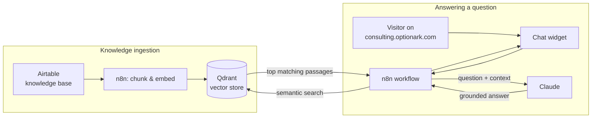
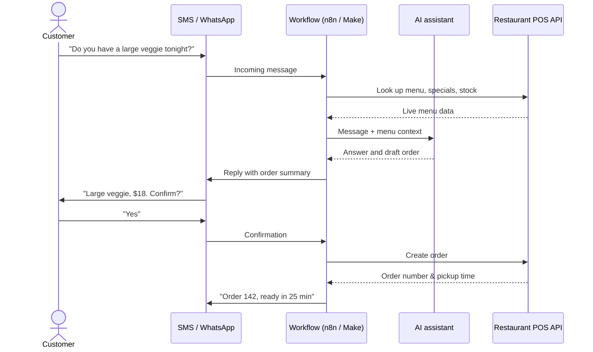
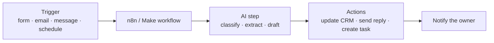
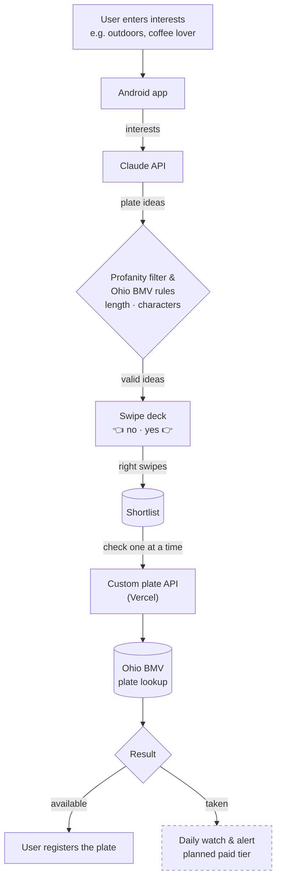
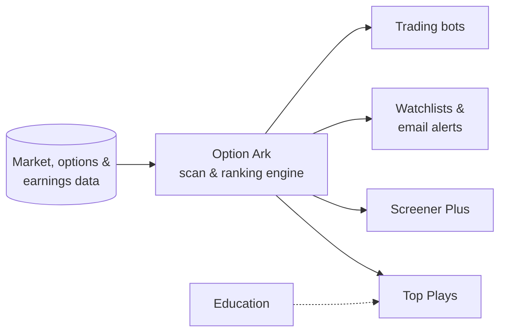
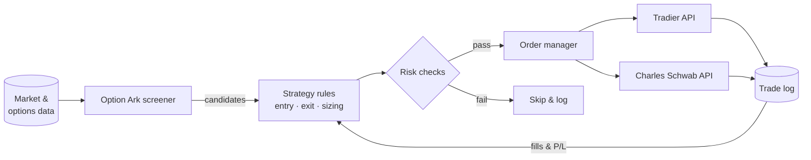
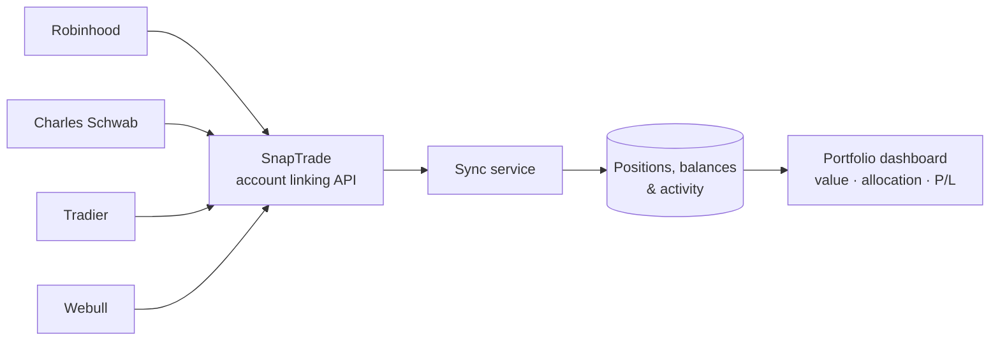

# Hi, I'm Jay 👋

I work on two separate initiatives:

- **🤖 AI and workflow automation consulting:** AI chatbots, ordering bots and n8n/Make workflows that take routine work off small businesses.
- **📈 Trading automation:** the Option Ark options screener, rule-based trading bots and a multi-broker portfolio dashboard.

Most of my code lives in private repositories. This page explains what each project does and how it works.

---

## 🤖 AI and workflow automation consulting

Through **Option Ark Consulting** ([consulting.optionark.com](https://consulting.optionark.com)) I help small businesses automate the busywork using n8n, Make and AI agents. The consulting site itself is a lightweight static site deployed on Render with automatic preview builds for every pull request.

### RAG knowledge chatbot (live on consulting.optionark.com)
A retrieval-augmented chatbot that answers visitor questions from a curated knowledge base instead of guessing. Content is managed in **Airtable**, embedded and stored in a **Qdrant** vector database, and an **n8n** workflow ties it together: it retrieves the most relevant passages for each question and has **Claude** write a grounded answer. Updating the bot is as simple as editing a row in Airtable.

### Text and WhatsApp ordering for restaurants
A repeatable package for local restaurants. Customers text or WhatsApp the shop to ask about specials, check what's in stock, or place an order. An AI assistant answers in plain language, builds the order, confirms it with the customer, and sends it straight into the restaurant's point-of-sale system, so staff never have to retype it.

### Small-business workflow automation
Custom n8n and Make workflows that connect a business's existing apps (email, forms, spreadsheets, CRMs, messaging) and add an AI step where judgment is needed, such as sorting requests, drafting replies or pulling data out of documents.

### Ohio vanity plate finder (Android proof of concept)
An unpublished Android app that makes picking a vanity plate feel like a dating app. The user enters a few interests (say, "outdoors" or "coffee lover"), and **Claude** generates plate ideas to match. Every idea is filtered for profanity and checked against Ohio BMV rules for length and allowed characters. The user swipes right on the ones they like and left on the rest.

Each right-swipe can then be checked against the Ohio BMV through a custom API, hosted on **Vercel**, that reports **available** or **taken**. If a plate is available, the user can go register it. The planned paid tier, designed but not built, would watch taken plates every day and alert the user when one frees up.

---

## 📈 Trading automation

### Option Ark: options income screener and education platform
[optionark.com](https://optionark.com) scans S&P 500 and Nasdaq stocks every hour during market hours for high-quality **covered call, cash-secured put, put credit spread and call credit spread** setups. It ranks them and explains them in plain language, so traders find good income setups before they go looking.

**How a setup gets picked**
- **Delta-targeted, short-dated entries** with a liquidity floor so every setup is tradeable
- **Minimum return thresholds** for each strategy, ranked by return on capital rather than raw premium
- **Earnings-aware:** setups too close to a report are held back automatically, and any setup that expires after an earnings date gets a ⚠ flag
- **Risk tiers:** Safe, Balanced and Growth, based on the quality of the underlying company

**Options-specific data on every setup**

| Metric | What it tells you |
| --- | --- |
| **IV Rank** | Where implied volatility sits against its own past year |
| **POP** | Estimated probability of profit |
| **Expected move** | The 1-standard-deviation price range by expiration |
| **Win-rate history** | Historic win/loss per ticker and strategy, plus a track record by strategy and delta |
| **ROC & annualized return** | Premium collected against capital at risk |
| **Delta, DTE, OI, RSI** | Odds, time, liquidity and momentum at a glance |

**Platform features**
- **Strategy Screener:** live filters by strategy, ticker, risk tier, delta, DTE, minimum ROC and RSI range, with sorting, side-by-side compare and CSV export
- **Most Active options** ranked by contract volume
- **Earnings calendar** with report dates, before-open/after-close timing and EPS estimates (data from Finnhub), plus a count of affected setups
- **Watchlists, saved screeners and daily email digests** that match a user's saved filters
- **Free and Plus tiers**, with a Pro tier coming soon: position tracker with profit-target and assignment-risk alerts, trade journal, income dashboard and deep-dive play pages

**Education**
A built-in learning section for newer traders. It starts with options basics (puts, calls, premium, strike, assignment). Then it gives each of the four strategies its own lesson with a worked example, a profit/loss diagram, max profit, max loss, break-even, capital needed, when it works best and what can go wrong. It ends with a side-by-side strategy comparison and a glossary of key terms like delta, IV Rank, ROC and POP.

### Trading bots
Python bots that turn screener signals into real orders. Each bot runs a rule-based strategy, sizes positions, places and manages orders (including multi-leg options orders), and logs every decision. They connect directly to brokerage APIs at **Tradier** and **Charles Schwab**.

### Multi-broker portfolio dashboard
One view of every account I hold, across brokers. The dashboard uses **SnapTrade** to securely link brokerage accounts and pull balances, positions and activity from **Robinhood, Charles Schwab, Tradier and Webull**, then rolls them up into total value, allocation and performance.

---

## 🧰 Tools and tech

| Area | What I use |
| --- | --- |
| Languages | Python, HTML/CSS, JavaScript |
| Brokerage APIs | Tradier, Charles Schwab, SnapTrade (Robinhood, Schwab, Tradier, Webull) |
| Automation | n8n, Make, AI agents |
| AI | Claude, RAG pipelines, Qdrant vector database |
| Data | Airtable |
| Messaging | SMS, WhatsApp |
| Hosting & DevOps | Render, Vercel, GitHub |

---

## 📫 Get in touch

- Email: [consulting@optionark.com](mailto:consulting@optionark.com)
- Consulting: [consulting.optionark.com](https://consulting.optionark.com)
- Trading tools: [optionark.com](https://optionark.com)

Happy to walk through any of these projects on a call.
