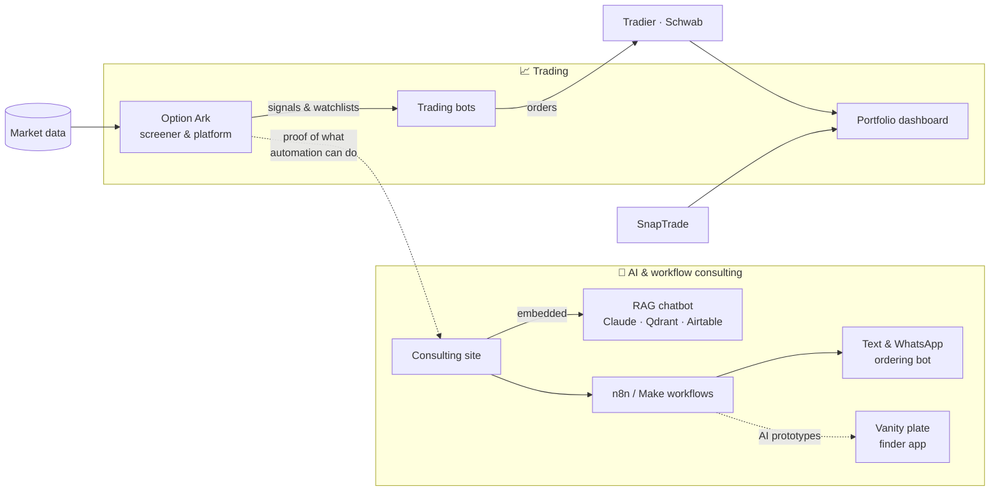
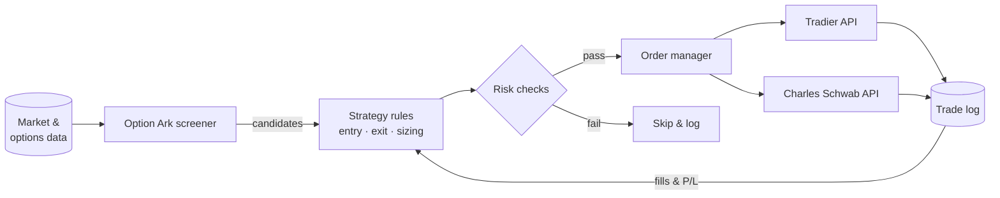
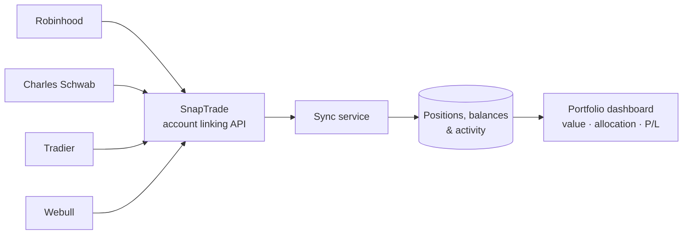
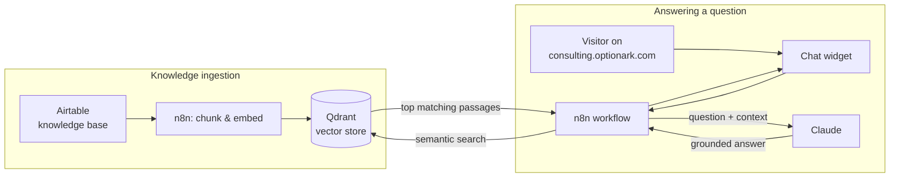
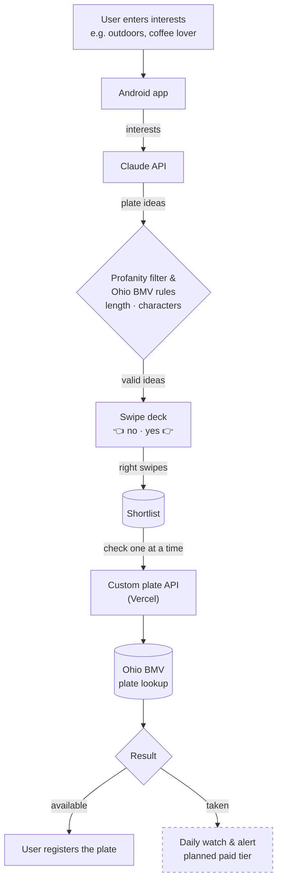
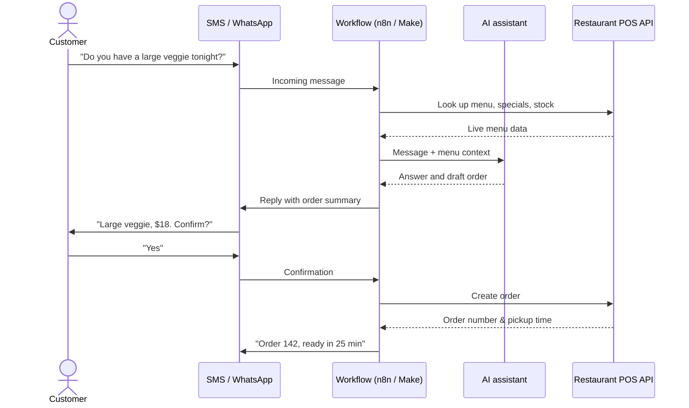
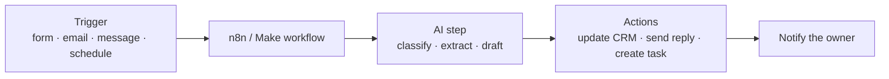

# Hi, I'm Jay 👋

I build automation for traders and small businesses. On the trading side that means options screeners, rule-based trading bots and a multi-broker portfolio dashboard. On the business side it means AI-powered workflows that connect the tools a company already uses, so routine work happens on its own.

Most of my code lives in private repositories. This page explains what each project does and how the pieces fit together.

---

## 🗺️ The big picture

---

## 📈 Trading automation

### Option Ark: options screener and trading platform
A Python platform behind [optionark.com](https://optionark.com). It pulls market and options-chain data, scores contracts against a set of strategy rules, and surfaces the best candidates as watchlists and alerts. It is the research layer that feeds the trading bots.

### Trading bots
Python bots that turn screener signals into real orders. Each bot runs a rule-based strategy, sizes positions, places and manages orders (including multi-leg options orders), and logs every decision. They connect directly to brokerage APIs at **Tradier** and **Charles Schwab**.

### Multi-broker portfolio dashboard
One view of every account I hold, across brokers. The dashboard uses **SnapTrade** to securely link brokerage accounts and pull balances, positions and activity from **Robinhood, Charles Schwab, Tradier and Webull**, then rolls them up into total value, allocation and performance.

---

## 🤖 AI and workflow automation consulting

Through **Option Ark Consulting** ([consulting.optionark.com](https://consulting.optionark.com)) I help small businesses automate the busywork using n8n, Make and AI agents. The consulting site itself is a lightweight static site deployed on Render with automatic preview builds for every pull request.

### RAG knowledge chatbot (live on consulting.optionark.com)
A retrieval-augmented chatbot that answers visitor questions from a curated knowledge base instead of guessing. Content is managed in **Airtable**, embedded and stored in a **Qdrant** vector database, and an **n8n** workflow ties it together: it retrieves the most relevant passages for each question and has **Claude** write a grounded answer. Updating the bot is as simple as editing a row in Airtable.

### Ohio vanity plate finder (Android proof of concept)
An unpublished Android app that makes picking a vanity plate feel like a dating app. The user enters a few interests (say, "outdoors" or "coffee lover"), and **Claude** generates plate ideas to match. Every idea is filtered for profanity and checked against Ohio BMV rules for length and allowed characters. The user swipes right on the ones they like and left on the rest.

Each right-swipe can then be checked against the Ohio BMV through a custom API, hosted on **Vercel**, that reports **available** or **taken**. If a plate is available, the user can go register it. The planned paid tier, designed but not built, would watch taken plates every day and alert the user when one frees up.

### Text and WhatsApp ordering for restaurants
A repeatable package for local restaurants. Customers text or WhatsApp the shop to ask about specials, check what's in stock, or place an order. An AI assistant answers in plain language, builds the order, confirms it with the customer, and sends it straight into the restaurant's point-of-sale system, so staff never have to retype it.

### Small-business workflow automation
Custom n8n and Make workflows that connect a business's existing apps (email, forms, spreadsheets, CRMs, messaging) and add an AI step where judgment is needed, such as sorting requests, drafting replies or pulling data out of documents.

---

## 🧰 Tools and tech

| Area | What I use |
| --- | --- |
| Languages | Python, HTML/CSS, JavaScript |
| Brokerage APIs | Tradier, Charles Schwab, SnapTrade (Robinhood, Schwab, Tradier, Webull) |
| Automation | n8n, Make, AI agents |
| AI | Claude, RAG pipelines, Qdrant vector database |
| Data | Airtable |
| Messaging | SMS, WhatsApp |
| Hosting & DevOps | Render, Vercel, GitHub |

---

## 📫 Get in touch

- Consulting: [consulting.optionark.com](https://consulting.optionark.com)
- Trading tools: [optionark.com](https://optionark.com)

Happy to walk through any of these projects on a call.
